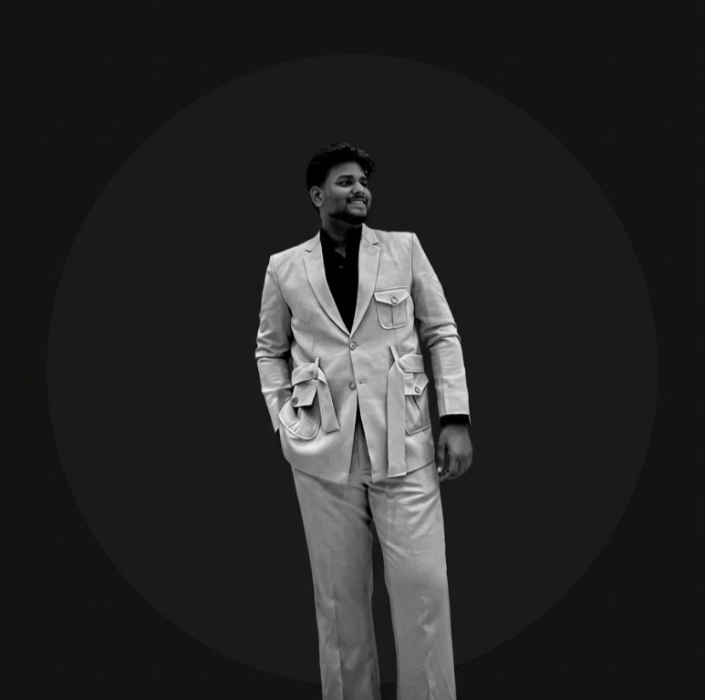
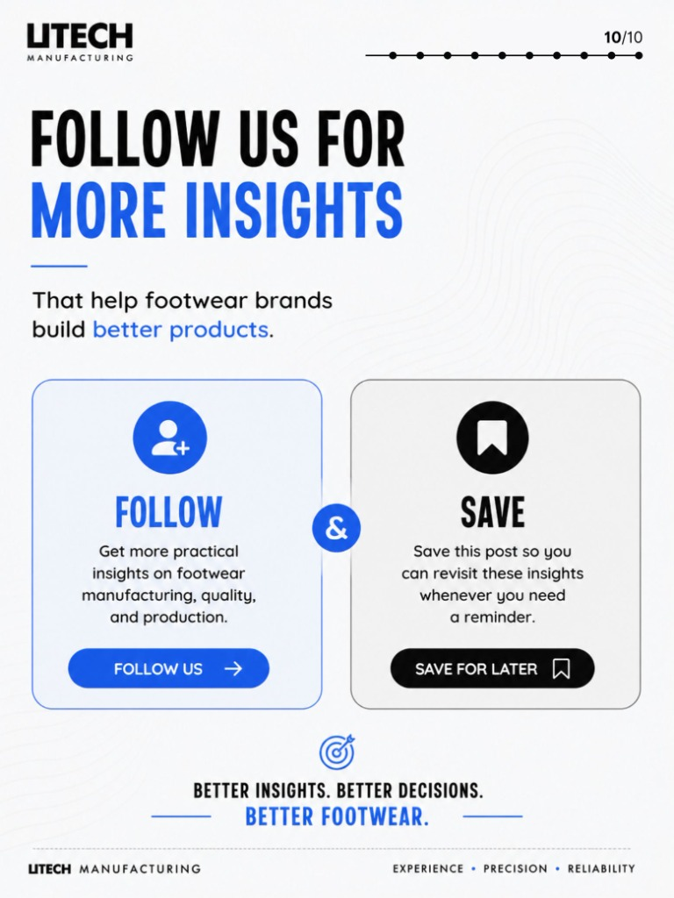
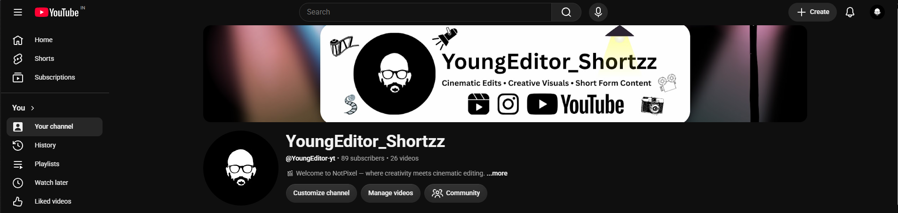
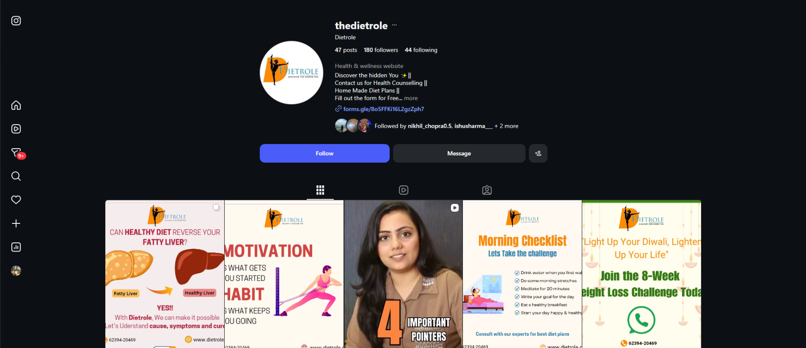

[Rohan Pathak](#home)

[Home](#home) [Services](#services) [About me](#about) [Projects](#projects) [Contact me](#contact) [Hire me](https://wa.me/919872653601?text=Hi%20Rohan%2C%20I%27d%20like%20to%20discuss%20hiring%20you.)

Digital Marketer and Growth Professional

# Reach the people you need.

I plan, create, and track social media content that puts your business in front of the right audience.

[See my work](#projects) [Download CV](./CV-resume-Digital%20marketing%20and%20growth%20professional.pdf)

- Audience tracking & targeting
- Content creation
- Research & analysis
- Social media algorithms
- Graphic design

## What I offer

**I help businesses reach the right audience and turn attention into customers, through social media, content, and design.**

### 1. Social Media Management

- Content calendars built around your audience and goals
- Platform-specific strategy for Instagram, Facebook, LinkedIn, and YouTube
- Community engagement and a consistent brand voice

### 2. Content Creation

- Posters, carousels, and ad creatives designed in Canva
- Short-form video and reels edited in CapCut, built for strong hooks and fast pacing
- Caption and ad copywriting, with AI used to speed up research and drafts

### 3. Audience Research and Targeting

- Audience and demographic analysis
- Competitor research and content gap analysis
- Customer persona building

### 4. Paid Ads (Meta)

- Campaign setup, targeting, and creative testing
- A/B testing of creatives and audiences
- Budget tracking and optimisation based on results

### 5. SEO Support

- Off-page SEO: backlinks and directory submissions
- Keyword research using SEMrush
- Basic on-page SEO: titles, meta descriptions, and Search Console checks

### 6. Analytics and Reporting

- Performance tracking in Meta Business Suite and Google Analytics
- Simple monthly reports that explain what worked, what didn’t, and what to change next

### 7. Brand Positioning

- Messaging and tone of voice, especially for B2B and manufacturing brands
- Consistent visual identity across posts, ads, and creatives

## Who is behind the work

Add your photograph here

I'm Rohan, a 20-year-old digital marketer and growth professional from Ludhiana, Punjab. I've worked in this field for the past three years. I put the right content in front of the right people and use performance data to learn what works.

Good marketing starts with knowing exactly who you are talking to.

Alongside my client work, I edit fast-paced car transition videos for YouTube. This hobby keeps my eye for pacing and visuals sharp.

- Based inLudhiana, Punjab
- LanguagesEnglish, Hindi, Punjabi
- ToolsCanva, CapCut, Meta Business Suite, Google Analytics, SEMrush

## Work I've made

### U-Tech social content

Posters and carousels made to bring in clients for a shoe manufacturing brand.

### Car edit videos

Fast-paced transition videos of cars, published on YouTube.

### The Dietrole page

A brand page built around social presence and follower growth.

[See all →](./experience.html)

## Start a conversation

Hiring for a marketing role? Send me a message and I'll reply as soon as I can.

Your name Your email Company or role you’re hiring for Your message

Each button opens a prefilled message in Gmail or WhatsApp for you to review and send.

**Rohan Pathak**Digital Marketer and Growth ProfessionalLudhiana, Punjab, India.

**Contact**[rohanpathak2971@gmail.com](mailto:rohanpathak2971@gmail.com)+91 98726 53601[WhatsApp](https://wa.me/919872653601)

**Sections**[Home](#home)[Services](#services)[About me](#about)[Projects](#projects)[Contact me](#contact)

Details of past roles and supporting documents are available on request. © 2026 Rohan Pathak. All rights reserved.
